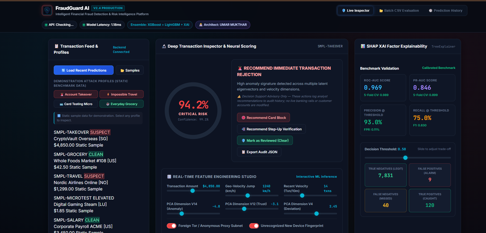
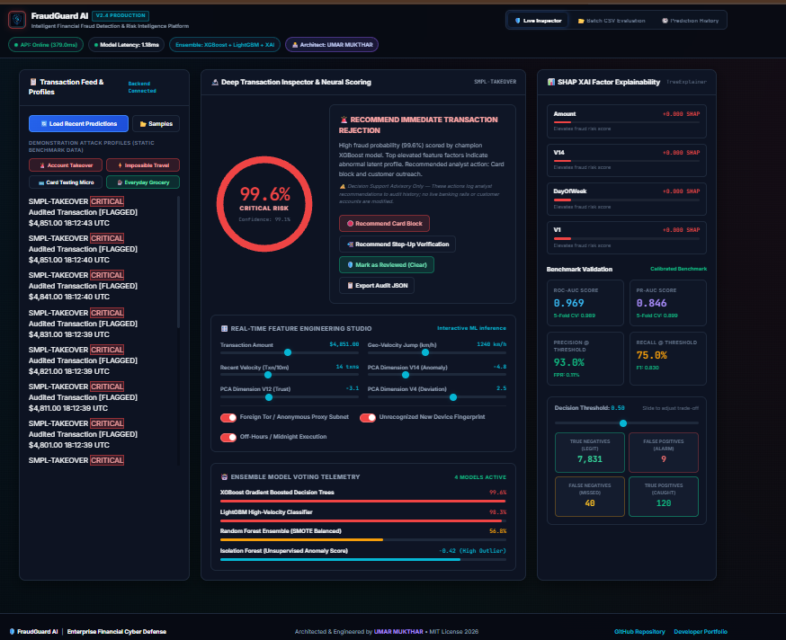
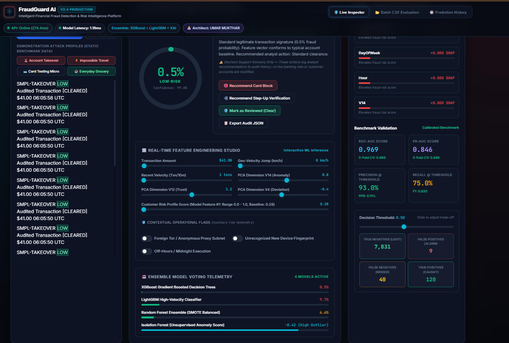
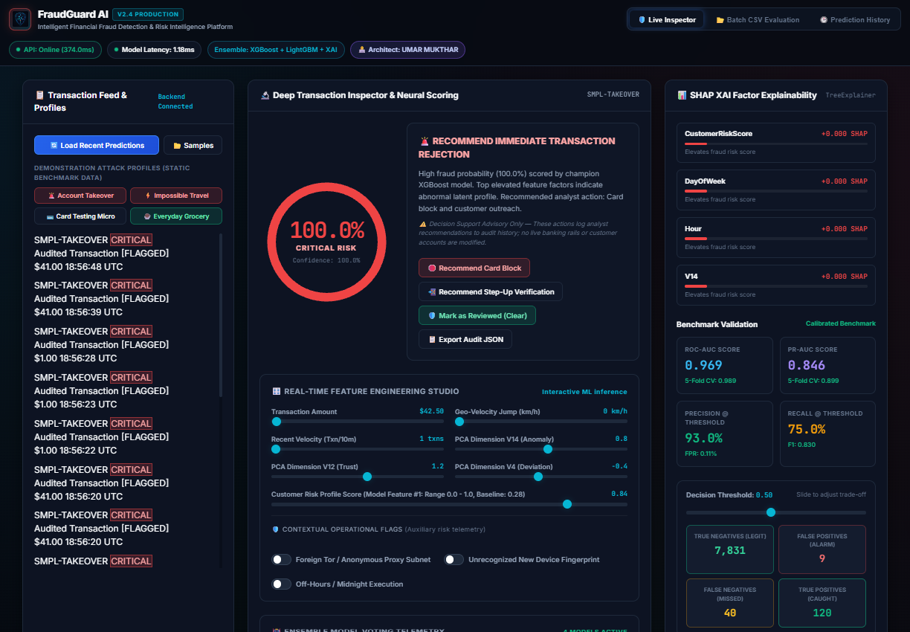
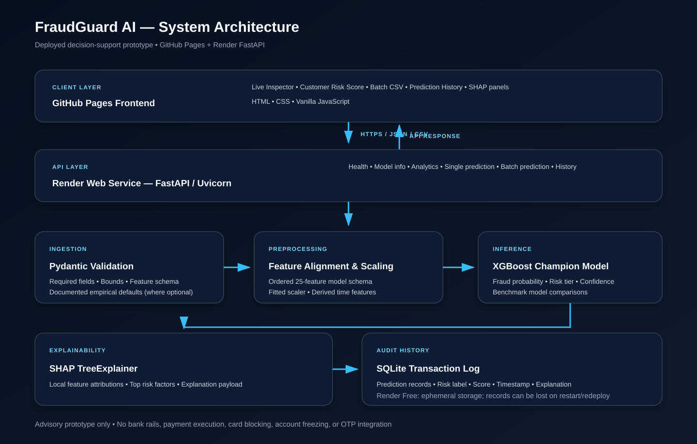

# FraudGuard AI — Financial Fraud Detection & Risk Analytics Prototype

[](https://umarmukthar03.github.io/fraud-detection-system/)
[](https://fraudguard-ai-api-2xab.onrender.com/docs)
[](https://www.python.org/)
[](LICENSE)

**FraudGuard AI** is a deployed, full-stack fraud-detection decision-support prototype. It combines an interactive browser dashboard, a FastAPI inference service, an XGBoost classifier, SHAP feature explanations, CSV batch scoring, and a transaction-history view.

> **Important scope:** This is an educational/portfolio prototype evaluated on a calibrated synthetic benchmark. It is not a bank-integrated payment system, has not been validated on live bank/cardholder traffic, and must not be used to make real financial decisions. Its controls produce recommendations only; they do not block cards, reject payments, debit accounts, or send OTPs.

## Live application

| Component | URL | Hosting |
|---|---|---|
| Web dashboard | [Open FraudGuard AI](https://umarmukthar03.github.io/fraud-detection-system/) | GitHub Pages |
| Backend health | [Check API health](https://fraudguard-ai-api-2xab.onrender.com/health) | Render Free |
| Interactive API docs | [Open Swagger UI](https://fraudguard-ai-api-2xab.onrender.com/docs) | Render Free |
| Source code | [GitHub repository](https://github.com/UMARMUKTHAR03/fraud-detection-system) | GitHub |

The free Render instance may sleep when inactive, so its first request after inactivity can be slower. SQLite prediction history is stored on ephemeral service storage and can be lost after restart, scale-to-zero, or redeployment. Do not submit personal, financial, or other sensitive data to this public demo.

## Key capabilities

- **Live transaction inspector:** interactive transaction feature controls and risk scoring through the deployed API.
- **Fraud risk tiers:** LOW, MEDIUM, HIGH, and CRITICAL classifications derived from the configured decision thresholds.
- **Customer risk profile:** explicit `CustomerRiskScore` input with a documented 0–1 range and a displayed population baseline.
- **Explainable predictions:** SHAP TreeExplainer feature attributions for individual predictions.
- **Batch scoring:** JSON batch and CSV upload workflows, including downloadable CSV results.
- **Prediction history:** recent prediction records stored in SQLite during the running Render instance lifetime.
- **Model and service telemetry:** health status, model metadata, benchmark metrics, processing latency, and analytics endpoints.
- **Operational context indicators:** Tor/proxy, unknown-device, and off-hours switches are labelled as auxiliary telemetry; they are not independent model inputs in the current trained feature schema unless explicitly mapped in a future model version.

## Screenshots

The following are actual screenshots supplied during manual verification of the deployed application. They are not mockups.

### Live dashboard



### Critical-risk example



### Legitimate low-risk example



### Connected dashboard and transaction feed



> Batch CSV and Prediction History workflows were also manually reported as tested. Dedicated screenshots for those two views were not included in the supplied screenshots, so this README does not present fabricated images for them. Add genuine captures to `docs/screenshots/` when available.

## Architecture



### Prediction flow

1. The browser sends a JSON transaction or CSV batch to the FastAPI service over HTTPS.
2. Pydantic validates the request schema and field bounds.
3. The API aligns inputs to the ordered 25-feature model schema and applies the fitted scaler. Derived time features and documented population defaults are used where the API supports omitted optional fields.
4. The XGBoost champion model returns a fraud probability and risk level.
5. SHAP TreeExplainer creates local feature attributions for the result.
6. The API returns the prediction and logs a history record to SQLite (ephemeral on Render Free).

## Model evaluation

The repository's `models/metrics.json` reports the following holdout results for the selected XGBoost model:

| Metric | Holdout result |
|---|---:|
| Accuracy | 99.04% |
| Precision | 82.89% |
| Recall | 77.50% |
| F1-score | 0.8010 |
| ROC-AUC | 0.9691 |
| PR-AUC | 0.8463 |
| False positives | 32 |
| False negatives | 45 |

The benchmark contains 40,000 generated/calibrated transaction records, with 32,000 training records, 8,000 holdout records, and an approximately 2% fraud prevalence. These metrics describe the benchmark split only. They are not real-world banking performance guarantees.

The XGBoost holdout confusion-matrix counts recorded in the benchmark are 7,768 true negatives, 32 false positives, 45 false negatives, and 155 true positives. LightGBM recorded 100 false positives on the same holdout evaluation: XGBoost therefore produced 68 fewer false positives at the evaluated operating point. This is a count comparison, not a claim about customer friction or production impact.

### Latency note

The benchmark's approximately 1.18 ms median model inference latency is an isolated local model measurement. It does not represent end-to-end public API latency, cold-start time, network latency, database writes, or SHAP computation on Render.

## Feature schema and missing values

The current model schema contains `Time`, `Amount`, `V1`–`V20`, derived `Hour` and `DayOfWeek`, and `CustomerRiskScore` (25 ordered features). `CustomerRiskScore` is validated to the range 0–1. The backend contains empirical population defaults for fields that it permits to be omitted; imputation is a modelling assumption, not an observed customer value. Callers should send complete, correctly transformed feature vectors wherever possible and should not treat imputed PCA values as measured data.

The UI's contextual operational flags are auxiliary telemetry. They should not be described as affecting the model probability unless the request schema, trained feature set, and model are updated together to include them.

## API reference

| Method | Endpoint | Purpose |
|---|---|---|
| `GET` | `/` | Service information |
| `GET` | `/health` | Health and model-loaded status |
| `GET` | `/model-info` | Active model and feature metadata |
| `GET` | `/analytics` | Benchmark analytics and feature information |
| `GET` | `/metrics` | Request and service telemetry |
| `GET` | `/history` | Prediction-history records (public demo; do not store sensitive data) |
| `GET` | `/sample-template` | CSV input template |
| `POST` | `/predict` | Single transaction prediction with SHAP explanation |
| `POST` | `/predict/batch` | JSON batch prediction |
| `POST` | `/predict-batch` | CSV upload and optional downloadable results |

The current repository also defines `POST /reload-models`. **It must be protected by an administrative secret or disabled before the API is used beyond a public demo.** Do not expose an unauthenticated model-reload action to untrusted callers.

## Local development

### 1. Clone and create a virtual environment

```bash
git clone https://github.com/UMARMUKTHAR03/fraud-detection-system.git
cd fraud-detection-system
python -m venv .venv

# Windows PowerShell
.venv\Scripts\Activate.ps1

# macOS / Linux
source .venv/bin/activate
```

### 2. Install dependencies

```bash
python -m pip install --upgrade pip
pip install -r requirements.txt
```

> The current `requirements.txt` uses lower-bound version constraints, not a fully pinned lockfile. A reproducible lock should be generated and tested in the project's Python 3.11 environment before claiming deterministic installs.

### 3. Run the API

```bash
uvicorn src.api.fraud_api:app --host 127.0.0.1 --port 8000 --reload
```

Open [http://127.0.0.1:8000/docs](http://127.0.0.1:8000/docs) for the interactive API documentation.

### 4. Run tests

```bash
python -m pytest tests/ -v
```

The latest local run reported by the project maintainer was **25 passed**. This result has not been independently rerun in this documentation bundle. Re-run the command in the current checkout before relying on that count.

## Deployment

### Frontend — GitHub Pages

The published frontend is served from the `gh-pages` branch. The current `index.html` and `404.html` files are synchronized in the repository.

### Backend — Render Free

The backend is configured by `render.yaml` as a Python web service using `uvicorn src.api.fraud_api:app`. The deployed service URL is `https://fraudguard-ai-api-2xab.onrender.com`.

Render Free does not provide persistent disks for this service. `DATA_DIR` therefore points to temporary service storage; SQLite prediction history may be reset when the instance restarts or redeploys. The live frontend can be configured to use the deployed backend through its API status/settings control.

For backend code changes, review the diff, run tests, commit to `main`, and confirm the Render deployment is healthy before treating the change as live. For frontend changes, publish the matching files to `gh-pages` and verify the GitHub Pages site after the update.

## Security, privacy, and limitations

- This is a public portfolio prototype, not a hardened financial service.
- Do not submit actual payment-card data, personal information, credentials, or confidential transactions.
- Prediction history is publicly accessible in the current demo API and is not suitable for confidential data.
- The model-reload endpoint requires protection or removal before broader public use.
- CORS is not authentication. A public browser client cannot keep an administrative secret.
- Add API gateway rate limiting, request-size limits, monitoring, authentication/authorization, secret management, and durable managed storage before any real deployment.
- No bank/payment processor integration, PCI assessment, production authorization workflow, live card blocking, account freezing, or OTP delivery is implemented.
- Performance and model metrics are based on the synthetic benchmark and local isolated timing experiments.

## Repository structure

```text
fraud-detection-system/
├── docs/
│   ├── architecture.svg
│   └── screenshots/
├── models/                 # Trained model, scaler, explainer, feature schema, metrics
├── src/
│   ├── api/                 # FastAPI application
│   ├── data_processing/    # Data generation and feature engineering
│   └── models/              # Training pipeline and model wrappers
├── tests/                  # API, feature-engineering, and model tests
├── index.html              # Browser dashboard
├── 404.html                # GitHub Pages SPA fallback
├── render.yaml             # Render service configuration
├── Dockerfile
├── requirements.txt
└── README.md
```

## License

Released under the [MIT License](LICENSE).

---

**Author:** [Umar Mukthar](https://github.com/UMARMUKTHAR03)
