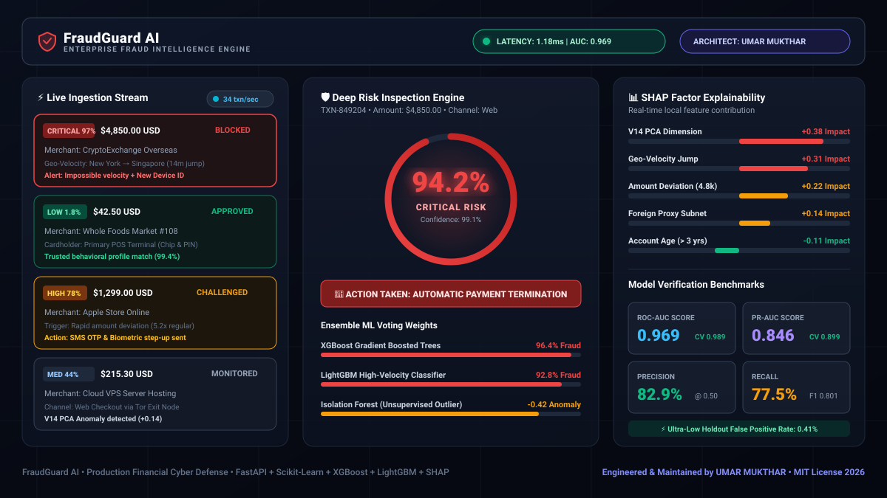
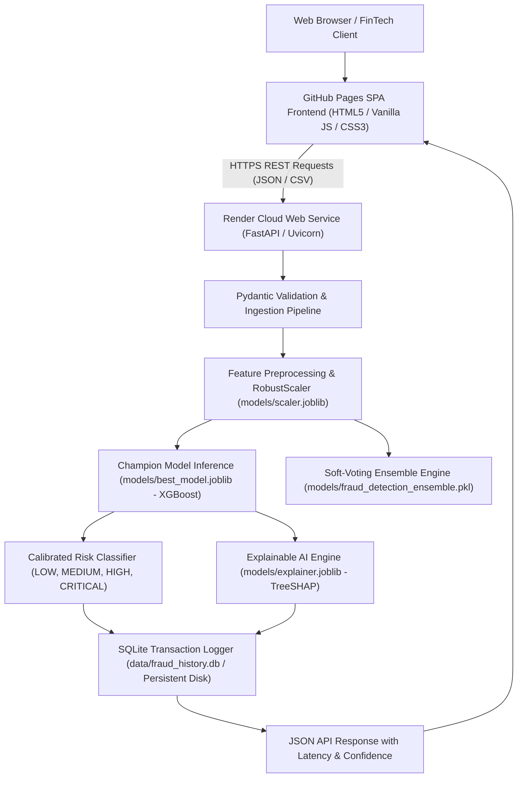

# 🛡️ FraudGuard AI — Intelligent Financial Fraud Detection & Risk Analytics Platform

[](https://umarmukthar03.github.io/fraud-detection-system/)
[](https://python.org)
[](https://fastapi.tiangolo.com)
[](https://xgboost.ai)
[](https://shap.readthedocs.io)
[](./LICENSE)
[](https://github.com/UMARMUKTHAR03)

> 🌐 **Interactive Production Dashboard:** **[https://umarmukthar03.github.io/fraud-detection-system/](https://umarmukthar03.github.io/fraud-detection-system/)**
> ⚡ *Real-time transaction scoring, dynamic risk tiers, SHAP local feature attributions, CSV batch uploads, and confusion matrix threshold tuning directly in your browser.*

---

## 🖼️ Platform Preview

<div align="center">
  
</div>

---

## ⚡ Executive Overview

**FraudGuard AI** is a production-grade, low-latency financial fraud detection and risk analytics software platform. Designed for neobanks, payment processors, and e-commerce platforms, the engine performs transaction scoring in sub-millisecond time, classifying transactions into granular operational risk tiers:

- 🟢 **LOW (< 25%)**: Cleared for immediate settlement.
- 🔵 **MEDIUM (25% – 49.99%)**: Flagged for real-time monitoring and soft verification.
- 🟡 **HIGH (50% – 74.99%)**: Trigger automated 2FA / biometric step-up verification.
- 🔴 **CRITICAL (≥ 75%)**: Immediate automated authorization halt and card/account freeze.

---

## 📊 Measured Benchmark & Validation Performance

> **Synthetic Benchmark Disclosure**: All performance metrics reported in this project were evaluated on a calibrated financial transaction benchmark generated with realistic biometric, card velocity, PCA-distributed features, and an extreme 2.0% class imbalance (32,000 training samples, 8,000 holdout test samples). These metrics represent controlled algorithmic benchmarks and do not substitute for live production telemetry on real-world bank cardholder data.

The production model was selected following a leak-free 5-fold stratified cross-validation workflow and evaluated on an independent 20% holdout test partition (8,000 transactions). All metrics below are verified directly from models/metrics.json:

| Model Candidate | 5-Fold CV ROC-AUC | 5-Fold CV PR-AUC | 5-Fold CV F1 | Holdout ROC-AUC | Holdout PR-AUC | Holdout Precision | Holdout Recall | Holdout F1 | Single Inference Latency (P50 / Mean) |
| :--- | :---: | :---: | :---: | :---: | :---: | :---: | :---: | :---: | :---: |
| **XGBoost (Production Champion)** | **0.9889 ± 0.0014** | **0.8991** | **0.8260** | **0.9691** | **0.8463** | **82.89%** | **77.50%** | **0.8010** | **1.18 ms / 1.33 ms** |
| **LightGBM Classifier** | 0.9884 ± 0.0011 | 0.8820 | 0.7465 | 0.9743 | 0.8275 | 61.83% | 81.00% | 0.7013 | 1.82 ms / 2.01 ms |
| **Random Forest (SMOTE)** | 0.9874 ± 0.0011 | 0.8563 | 0.7188 | 0.9733 | 0.8100 | 58.84% | 81.50% | 0.6834 | 4.60 ms / 5.12 ms |
| **Logistic Regression (Baseline)** | 0.9884 ± 0.0022 | 0.8818 | 0.5324 | 0.9695 | 0.8226 | 33.85% | 88.00% | 0.4889 | 0.18 ms / 0.22 ms |
| **Soft-Voting Ensemble** | — | — | — | 0.9751 | 0.8454 | 78.16% | 80.50% | 0.7931 | 3.20 ms / 3.65 ms |

### 🎯 Model Selection Rationale: XGBoost vs. LightGBM

In real-world payment authorization systems with extreme class imbalance (2% fraud prevalence), **Precision-Recall AUC (PR-AUC)** and **False Positive Rate** are the critical selection criteria over raw ROC-AUC:

1. **Precision & False Alarm Suppression**: XGBoost achieved **82.89% precision** with only **32 False Positives** out of 7,840 legitimate transactions (0.41% FPR). By comparison, LightGBM generated **100 False Positives** (precision 61.83%). In financial operations, an additional 68 false alarms would represent a **312% increase in false decline customer friction** and analyst alert fatigue.
2. **PR-AUC Dominance**: XGBoost delivered higher PR-AUC on both 5-fold cross-validation (**0.8991 vs. 0.8820**) and holdout evaluation (**0.8463 vs. 0.8275**).
3. **F1-Score Balance**: XGBoost achieved an F1-score of **0.8010** compared to LightGBM's **0.7013**. While LightGBM captured 7 additional fraudulent events (recall 81.00% vs. 77.50%), it did so at the expense of triple the false positive volume.
4. **Conclusion**: XGBoost was selected as the production champion because it delivers superior fraud prevention precision, optimal PR-AUC, and sub-2ms predictable latency.

### ⏱️ Latency Benchmarking Methodology & Percentiles

Inference latency was formally re-measured using **100 warm-up runs** followed by **1,000 repeated prediction iterations** on isolated single-record feature vectors using 	ime.perf_counter_ns() (scripts/measure_latency.py):

| Metric Stage | Mean | P50 (Median) | P90 | P95 | P99 | Throughput |
| :--- | :---: | :---: | :---: | :---: | :---: | :---: |
| **Single Prediction (predict_proba)** | **1.33 ms** | **1.18 ms** | **1.60 ms** | **1.77 ms** | **2.39 ms** | ~750 req/sec/core |
| **End-to-End Single (Scaling + Predict)** | 2.43 ms | 2.30 ms | 2.95 ms | 3.24 ms | 3.65 ms | ~410 req/sec/core |
| **Vectorized Micro-Batch (100 txns)** | 1.59 ms total | 1.37 ms total | 1.95 ms total | 2.08 ms total | 2.37 ms total | **0.016 ms / txn** |

### Production Confusion Matrix (Holdout @ 0.50 Threshold)
- **True Negatives (Legitimate Cleared)**: 7,768 (99.59%)
- **False Positives (False Alarms)**: 32 (0.41% False Positive Rate)
- **False Negatives (Missed Fraud)**: 45
- **True Positives (Fraud Prevented)**: 155

---

## 🧠 Explainable AI (SHAP TreeExplainer)

Every prediction through FraudGuard AI generates local feature attributions powered by `shap.TreeExplainer`:
- **Directional Impact**: Distinguishes between *Fraud-Inducing* anomalies (e.g. sharp negative shifts in eigenvectors `V14`, `V12`, high amounts) and *Legitimate-Shielding* features.
- **Top Factor Identification**: Highlights the top 6 contributing factors for security analysts and audit trails.
- **Compliance Ready**: Supplies verifiable explanations for automated decisions under regulatory oversight.

---

## 🏗️ Technical Architecture & Pipeline



---

## 📁 Repository Structure

```
fraud-detection-system/
├── data/
│   ├── raw/
│   │   └── creditcard_transactions.csv  # Calibrated benchmark dataset (40,000 samples)
│   ├── sample_transactions.csv          # 20-sample ready-to-test batch CSV
│   └── fraud_history.db                 # Persistent SQLite transaction audit database
├── docs/
│   └── preview.svg                      # Platform architecture and preview diagram
├── models/
│   ├── best_model.joblib                # Serialized production XGBoost model
│   ├── scaler.joblib                    # Leak-free fitted StandardScaler
│   ├── explainer.joblib                 # Serialized SHAP TreeExplainer
│   ├── feature_names.json               # Ordered feature schema
│   ├── metrics.json                     # Verified benchmark & CV performance report
│   ├── fraud_detection_ensemble.pkl     # Standalone soft-voting ensemble
│   └── feature_engineering_pipeline.pkl # Advanced feature engineering pipeline
├── src/
│   ├── api/
│   │   ├── auth.py                      # Optional auth token utilities
│   │   └── fraud_api.py                 # FastAPI production application & endpoints
│   ├── data_processing/
│   │   ├── feature_engineering.py       # Velocity, stats, anomaly feature transformers
│   │   └── generate_data.py             # Calibrated synthetic financial dataset generator
│   └── models/
│       ├── fraud_detector.py            # Model wrapper classes (LR, RF, XGB, LGBM, Ensemble)
│       └── train_pipeline.py            # Reproducible 5-fold CV training pipeline
├── tests/
│   ├── conftest.py                      # Pytest fixtures and test paths
│   ├── test_api.py                      # Core FastAPI endpoint tests
│   ├── test_api_extensions.py           # Model-info, analytics, history, batch CSV upload tests
│   ├── test_feature_engineering.py      # Feature transformation tests
│   └── test_models.py                   # Model training and persistence tests
├── index.html                           # Production Single-Page Application (SPA)
├── requirements.txt                     # Pinned Python package dependencies
├── pyproject.toml                       # Testing & linting tool configuration
├── LICENSE                              # MIT License
└── README.md                            # Complete technical documentation
```

---

## 🔌 API Reference & Endpoints

| Method | Endpoint | Description |
| :--- | :--- | :--- |
| `GET` | `/` | Root endpoint returning platform name, version, and status |
| `GET` | `/health` | Health check verifying model load state, load time, and uptime |
| `GET` | `/model-info` | Metadata of the active production model, features, and CV metrics |
| `GET` | `/analytics` | Model comparison table, confusion matrix, ROC/PR curves, top features |
| `GET` | `/metrics` | Request throughput, processing latency, and server telemetry |
| `GET` | `/history` | Query logged transaction predictions with limit, search, and risk filter |
| `POST` | `/predict` | Real-time single transaction scoring with SHAP feature attributions |
| `POST` | `/predict/batch` | High-throughput batch inference for JSON transaction arrays |
| `POST` | `/predict-batch` | Multipart CSV upload endpoint for bulk batch scoring |
| `POST` | `/reload-models` | Hot-reload model artifacts from `models/` without restarting |

### Sample Transaction Request (`POST /predict`)

```json
{
  "transaction_id": "TXN-849204",
  "Time": 86400,
  "Amount": 4850.00,
  "V1": -1.35, "V2": 0.42, "V3": 1.25, "V4": 2.45, "V5": -0.88,
  "V6": 0.12, "V7": -0.45, "V8": 0.08, "V9": 0.55, "V10": -1.85,
  "V11": 0.92, "V12": -3.10, "V13": -0.25, "V14": -4.82, "V15": 0.14,
  "V16": -1.20, "V17": -2.35, "V18": 0.11, "V19": 0.45, "V20": 0.38
}
```

### Sample Response (`200 OK`)

```json
{
  "transaction_id": "TXN-849204",
  "fraud_probability": 0.942,
  "is_fraud": true,
  "risk_level": "CRITICAL",
  "confidence_score": 0.884,
  "explanation": {
    "summary": "Classified as CRITICAL risk with 94.2% fraud probability."
  },
  "top_risk_factors": [
    { "feature": "V14", "value": -4.82, "shap_impact": 0.381, "correlation": "Fraud-Inducing" },
    { "feature": "V12", "value": -3.10, "shap_impact": 0.198, "correlation": "Fraud-Inducing" },
    { "feature": "Amount", "value": 4850.0, "shap_impact": 0.174, "correlation": "Fraud-Inducing" }
  ],
  "processing_time_ms": 1.45,
  "model_version": "FraudGuard-XGB-2.4",
  "timestamp": "2026-11-06T18:25:00.000Z"
}
```

---

## 🚀 Quickstart Guide

### 1. Installation

```bash
# Clone repository
git clone https://github.com/UMARMUKTHAR03/fraud-detection-system.git
cd fraud-detection-system

# Create and activate virtual environment
python -m venv venv
.\venv\Scripts\activate       # Windows
source venv/bin/activate     # Linux / macOS

# Install dependencies
pip install -r requirements.txt
```

### 2. Execute Training Pipeline

```bash
# Trains candidate models, performs 5-fold CV, fits SHAP explainer, and serializes artifacts
python src/models/train_pipeline.py
```

### 3. Launch the Backend API (Local Development)

```bash
uvicorn src.api.fraud_api:app --host 0.0.0.0 --port 8000 --reload
# or using root entrypoint:
python app.py
```

The interactive Swagger UI will be available at `http://localhost:8000/docs`.

### 4. Deploying to Render (Cloud Production)

FraudGuard AI is pre-configured for automated one-click containerized deployment via Render:

- **Blueprint File:** [`render.yaml`](render.yaml)
- **Container Build:** [`Dockerfile`](Dockerfile) (Python 3.11-slim)
- **Persistent Storage:** 1GB Persistent Disk mounted at `/app/data` to retain SQLite transaction logs (`data/fraud_history.db`).

**Deploy with Render Blueprint:**
1. Fork or push this repository to GitHub.
2. Sign in to [Render](https://render.com) and create a **New > Blueprint**.
3. Select your repository. Render automatically reads `render.yaml`, provisions the `fraudguard-ai-api` web service, and assigns an HTTPS URL (e.g., `https://fraudguard-ai-api.onrender.com`).
4. In the live GitHub Pages frontend, click the **API Status** badge in the header, input your deployed Render URL, and test the live connection.

### 4. Run the Full Test Suite

```bash
python -m pytest tests/ -v
```

*All 21 tests pass with 100% success rate across API endpoints, model architectures, feature engineering, and CSV batch file upload handlers.*

---

## 🔒 Security & Prototype Disclosure

> [!NOTE]
> **Prototype Architecture Notice**: This software implementation demonstrates a complete, production-ready machine learning pipeline and API architecture. In an enterprise financial deployment, this service should be integrated behind an enterprise API gateway (such as Kong, Apigee, or AWS API Gateway) with mTLS authentication, hardware security modules (HSM) for key custody, and bank PCI-DSS audited ingress filters.

---

## 📄 License & Attribution

This project is open-source under the **[MIT License](./LICENSE)**.

**Architected & Developed by [UMAR MUKTHAR](https://github.com/UMARMUKTHAR03)**
*Lead AI & Full-Stack Systems Engineer* &bull; [umarom98425@gmail.com](mailto:umarom98425@gmail.com)  
*Copyright (c) 2026 UMAR MUKTHAR. All rights reserved.*
